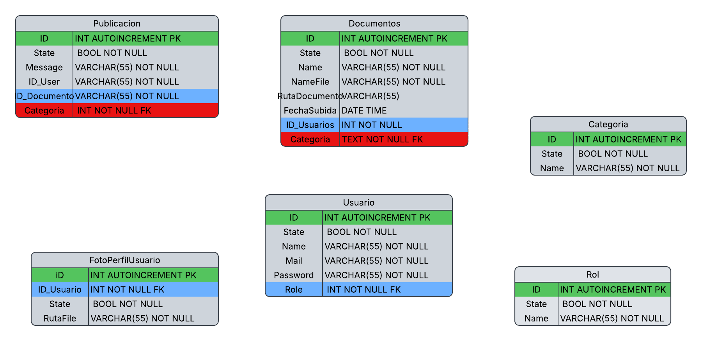
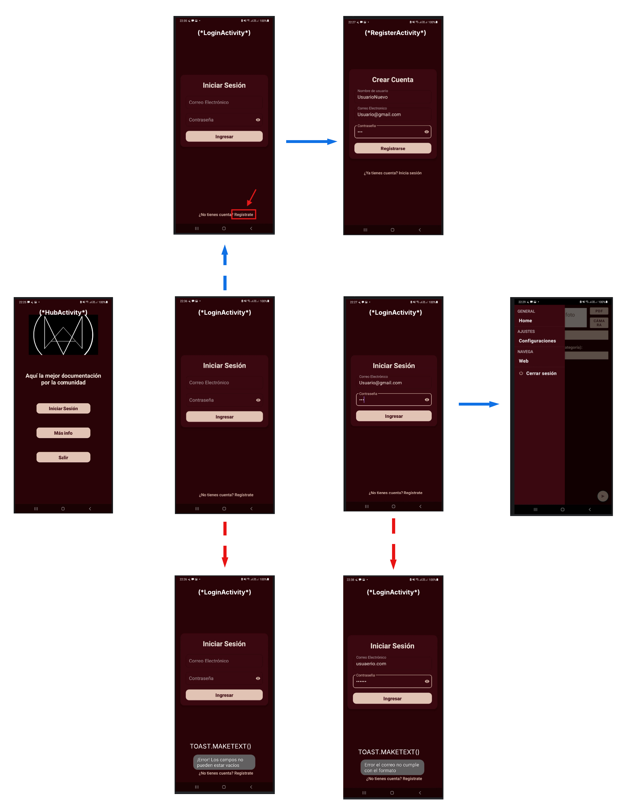
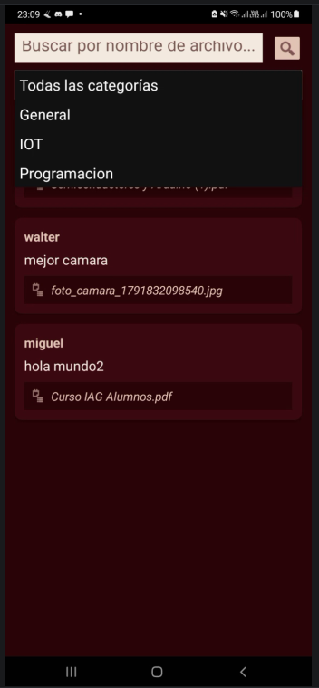
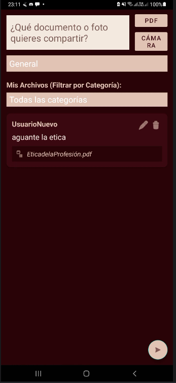
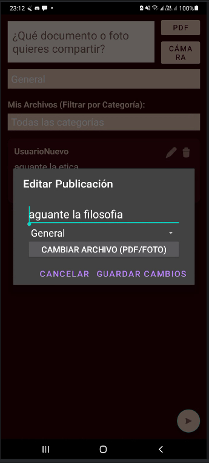

# 📌 Título y Ficha del Proyecto: DocuFind (Biblio Tecno)

**DocuFind** (inscrita formalmente bajo el nombre *Biblio Tecno*) es una aplicación móvil nativa para Android estructurada como una red social documental.

* **Integrantes:** Miguel Castillo
* **Docente a Cargo:** Leopoldo Rodriguez, Esteban Bravo
* **Asignatura:** Programación Android
* **Institución:** Santo Tomás Iquique
* **Versión de Android SDK:** Min SDK 24 (Android 7.0) / Target SDK 34 (Android 14)

---

## 🎯 Propósito y Problema que Resuelve

**El Problema:** La descentralización de la información académica. Frecuentemente, estudiantes y profesionales tienen material de estudio, apuntes y manuales dispersos en chats, correos o almacenamiento físico, lo que dificulta el acceso rápido y el aprendizaje colaborativo.

**La Solución (Propósito):** DocuFind resuelve esto proporcionando una plataforma centralizada y estructurada donde los usuarios pueden subir, organizar y compartir documentos. Consolida un ecosistema colaborativo mediante un "muro global" de acceso libre donde la comunidad puede buscar, filtrar y consumir apuntes o material de estudio de forma inmediata.

---

## 🛠️ Stack Tecnológico & Requisitos

* **Lenguaje de Programación:** Java
* **Entorno de Desarrollo:** Android Studio
* **SDK Mínimo:** API Level 24 (Android 7.0 Nougat)
* **Base de Datos Local:** SQLite.
* **Arquitectura:** Single-Activity Architecture con múltiples `Fragments` (Home, Web) e interfaces dinámicas manejadas por `RecyclerViews`.
* **Componentes Modernos:** Uso de `ActivityResultLaunchers` para Intents asíncronos y `FileProvider` para la visualización segura de documentos externos mediante URIs.

---

## 🗄️ Arquitectura de Base de Datos (Esquema M.E.R.)

La aplicación utiliza SQLite con un sistema relacional normalizado compuesto por 6 tablas. El esquema define políticas estrictas de integridad referencial (`ON DELETE CASCADE`) para evitar datos huérfanos al eliminar usuarios o categorías.

<p align="center">
  
</p>

---

## 🗺️ Flujo de Usuario y Arquitectura de Pantallas (UI Flow)

El siguiente diagrama detalla la navegación completa de la aplicación, abarcando las pantallas de autenticación, registro, manejo de excepciones por validación de campos y el acceso al contenido principal en el Hub:

<p align="center">
  
</p>

---

## 📱 Capturas de Pantalla Principales

| 1. Feed Global (WebFragment) | 2. Mis Publicaciones (HomeFragment) | 3. Edición / Borrado Lógico |
| :---: | :---: | :---: |
|  |  |  |
| *Exploración de la red social con motor de búsqueda y filtros por categoría.* | *Creación de posts con soporte dual: adjuntar PDF o capturar foto con cámara.* | *Gestión CRUD privada con actualización de documentos y soft delete.* |

---

## 🚀 Guía de Instalación y Ejecución

Sigue estos pasos para clonar y ejecutar el proyecto en tu entorno local:

**1. Clonar el repositorio**
Abre tu terminal o Git Bash y ejecuta:
```bash
git clone [https://github.com/Miguel777png/DocuFind.git](https://github.com/Miguel777png/DocuFind.git)
```

**2. Abrir en Android Studio**

Inicia Android Studio.

Selecciona File > Open y busca la carpeta DocuFind que acabas de clonar.

Espera a que Gradle sincronice las dependencias del proyecto.

**3. Configuración del Emulador / Dispositivo Físico**

Asegúrate de tener un emulador configurado (AVD) con API 24 o superior, o conecta tu dispositivo físico con la Depuración USB activada.

**4. Compilar y Ejecutar**

Haz clic en el botón verde de Run 'app' (o presiona Shift + F10).

La base de datos SQLite y las categorías por defecto se crearán automáticamente durante el primer inicio de la aplicación gracias a la clase DocuFindDbHelper.

